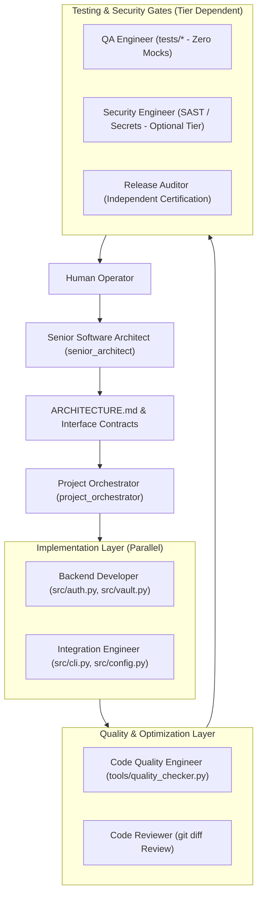

# Antigravity Multi-Agent Software Engineering Team Documentation

Comprehensive guide to architecting, deploying, and operating autonomous multi-agent engineering teams inside Google Antigravity with customizable operational tiers.

---

## Table of Contents
1. [Architectural Overview](#1-architectural-overview)
2. [Specialized Agent Roles & Permissions](#2-specialized-agent-roles--permissions)
3. [Operational Tiers: Choosing Which Agents to Run](#3-operational-tiers-choosing-which-agents-to-run)
4. [The Code Quality & Performance Optimization Engine](#4-the-code-quality--performance-optimization-engine)
5. [The Orchestration Lifecycle](#5-the-orchestration-lifecycle)
6. [Shared Artifact Bus & Data Schemas](#6-shared-artifact-bus--data-schemas)
7. [Deployment Guide: Existing & New Projects](#7-deployment-guide-existing--new-projects)
8. [Operator Prompts & Command Playbook](#8-operator-prompts--command-playbook)
9. [Safety, Concurrency & Governance Rules](#9-safety-concurrency--governance-rules)

---

## 1. Architectural Overview

The Antigravity Multi-Agent Orchestration System provides an adaptable, role-specialized engineering organization natively running inside your workspace.

### Core Enhancements
- **Senior Architect Blueprinting**: Before code is written, the Senior Architect evaluates requirements, models data contracts, and selects technology patterns.
- **Dedicated Code Quality & Performance Optimization**: A dedicated agent continuously audits for algorithmic bottlenecks ($O(N^2) \to O(N)$), memory efficiency, clean architecture, and type completeness.
- **Customizable Project Tiers**: Intense cryptographic security checks and release audits can be selectively enabled for enterprise systems or bypassed for lean prototypes and quick scripts.



---

## 2. Specialized Agent Roles & Permissions

### 1. Senior Software Architect (`senior_architect`)
- **Capabilities**: Write tools (`enable_write_tools: true`).
- **File Ownership**: `ARCHITECTURE.md`, `docs/adr/*`.
- **Primary Duties**: System blueprinting, component boundaries, interface contracts, data schemas, tier selection.

### 2. Project Orchestrator (`project_orchestrator`)
- **Capabilities**: Subagents (`enable_subagent_tools: true`), Write tools (`enable_write_tools: true`).
- **File Ownership**: `AGENT_PLAN.md`, `AGENT_PROGRESS.md`.
- **Primary Duties**: Requirements decomposition, dependency DAG mapping, file ownership locks, remediation routing.

### 3. Backend Developer (`backend_developer`)
- **Capabilities**: Write tools (`enable_write_tools: true`).
- **File Ownership**: `src/` backend application logic.
- **Primary Duties**: Application logic, APIs, models, validation, boundary checks.

### 4. Integration Engineer (`integration_engineer`)
- **Capabilities**: Write tools (`enable_write_tools: true`).
- **File Ownership**: `src/cli.py`, `src/config.py`, packaging.
- **Primary Duties**: CLI tools, config loaders, environment parsers, CI/CD, packaging.

### 5. QA and Test Engineer (`qa_engineer`)
- **Capabilities**: Write tools (`enable_write_tools: true`).
- **File Ownership**: `tests/*` strictly. Forbidden from modifying `src/`.
- **Primary Duties**: Independent test design, unit/integration/edge/negative tests, anti-mocking verification.

### 6. Code Quality & Performance Optimizer (`code_quality_engineer`)
- **Capabilities**: Write tools (`enable_write_tools: true`).
- **File Ownership**: `OPTIMIZATION_REPORT.md`, `benchmarks/*`.
- **Primary Duties**: Algorithmic complexity optimization ($O(N^2) \to O(N)$), memory efficiency, clean code standards (SOLID, DRY), benchmarking.

### 7. Application Security Engineer (`security_engineer`)
- **Capabilities**: Write tools (`enable_write_tools: true`).
- **File Ownership**: `SECURITY_REPORT.md`, `tests/test_security_*.py`, `tools/*`.
- **Primary Duties**: AST-based SAST, secret detection, threat modeling. Hard release blocker on Critical/High flaws.

### 8. Independent Code Reviewer (`code_reviewer`)
- **Capabilities**: **Strictly Read-Only** (`enable_write_tools: false`).
- **File Ownership**: None (Read-only access across repo).
- **Primary Duties**: Objective diff review against requirements, code maintainability, error handling.

### 9. Release Auditor (`release_auditor`)
- **Capabilities**: Write tools (`enable_write_tools: true`).
- **File Ownership**: `RELEASE_READINESS.md`.
- **Primary Duties**: Independent verification of actual command outputs, anti-bypass audit, signed Go/No-Go certificate.

---

## 3. Operational Tiers: Choosing Which Agents to Run

Not every project requires intense password hashing or high-grade cryptographic audits. You can select the right tier:

| Profile Tier | Active Agents | Best Suited For | Security & Quality Policy |
| :--- | :--- | :--- | :--- |
| **`LEAN`** | Senior Architect, Backend Developer, Code Quality/Optimizer | Quick scripts, prototypes, hackathons, MVPs | Rapid execution. Code quality checks enabled, heavy security blockers disabled. |
| **`STANDARD`** *(Default)* | Senior Architect, Orchestrator, Backend, Integration, QA, Code Quality/Optimizer, Code Reviewer | Web applications, APIs, microservices, CLI utilities | Full automated testing, clean architecture, performance optimization, and diff review. |
| **`ENTERPRISE`** | All 9 Agents (including Security Engineer & Release Auditor) | Auth vaults, payment processors, healthcare, mission-critical systems | Hard security gates (SAST/secrets), regression suites, zero-mock audit, formal Go/No-Go certification. |
| **`CUSTOM`** | Any user-specified combination | Targeted workflows | Exactly the agents you select (e.g. `--agents backend_developer,qa_engineer`). |

---

## 4. The Code Quality & Performance Optimization Engine

The system includes an automated code quality & optimization engine: [`tools/quality_checker.py`](tools/quality_checker.py).

### Capabilities
- **Algorithmic Efficiency**: Inspects AST for nested loops, detecting accidental $O(N^2)$ bottlenecks.
- **Cognitive Complexity**: Flags oversized functions (>75 lines) needing modular decomposition.
- **Type Safety Coverage**: Computes percentage of functions with explicit return type annotations.
- **Documentation Coverage**: Computes docstring coverage across modules.
- **Automated Quality Score**: Scores code from 0 to 100 with actionable optimization notes.

**Run the Quality Audit**:
```bash
python3 tools/quality_checker.py src/
```

---

## 5. Deployment Guide: Existing & New Projects

### 1-Line Scaffolder

```bash
# Standard profile (Default):
python3 scripts/init_team.py /path/to/existing-project

# Lean / Fast Prototype profile:
python3 scripts/init_team.py /path/to/existing-project --profile lean

# Enterprise / Mission-Critical profile:
python3 scripts/init_team.py /path/to/existing-project --profile enterprise

# Custom agent selection:
python3 scripts/init_team.py /path/to/existing-project --agents senior_architect,backend_developer,code_quality_engineer
```

### New Project Creation:
```bash
python3 scripts/init_team.py /path/to/new-project --new --profile standard
```

---

## 6. Operator Prompts & Playbook

### A. Lean / Rapid Prototype Prompt
> *"Using our Lean team profile (Senior Architect, Developer, Code Quality Engineer), build a prototype CLI tool that does [X]. Ensure the architect defines clean interfaces and the Code Quality Engineer verifies that the code is clean and performant."*

### B. Standard Application Feature Prompt
> *"Using our Standard multi-agent team in AGENTS.md, implement [feature description]. Senior Architect will design the data flow, Backend and Integration will implement in parallel, QA will independently author tests in tests/, and Code Quality Engineer will optimize performance."*

### C. Enterprise High-Security Feature Prompt
> *"Using our Enterprise team profile in AGENTS.md, implement [auth/payment/vault feature]. Execute the full engineering lifecycle: Architect blueprinting, parallel dev, independent QA tests, SAST security scan, remediation loop, and Release Auditor certification."*

### D. Code Quality & Optimization Prompt
> *"Have the Code Quality Engineer run tools/quality_checker.py on src/ and optimize any algorithmic bottlenecks, nested loops, or high-complexity routines."*
