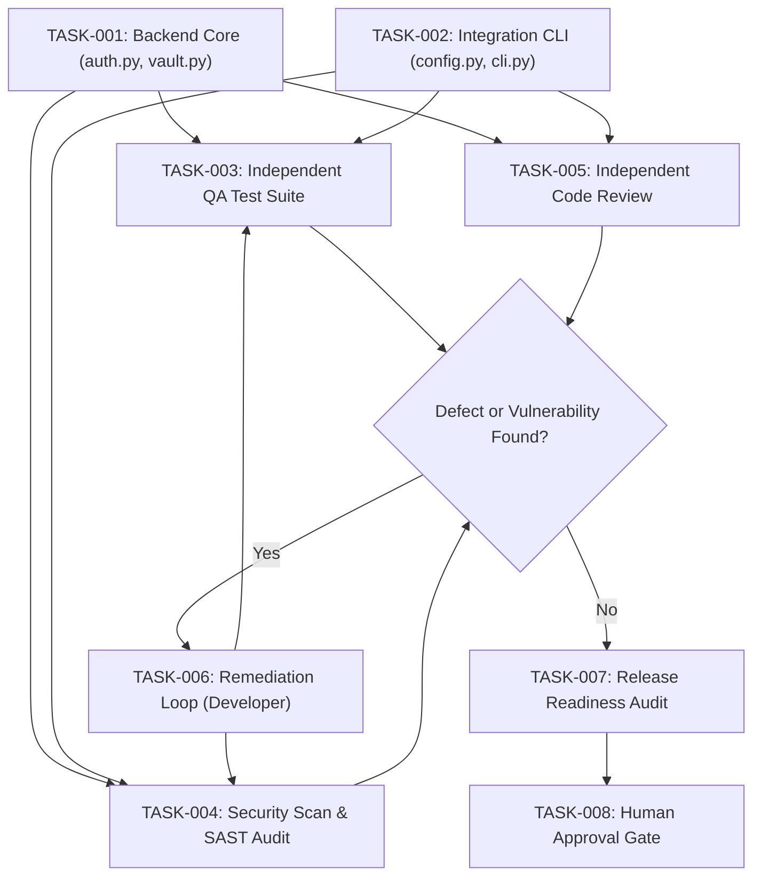

# Agent Plan & Task Decomposition: SecureVault Service

## 1. Project Objective & Scope
- **Feature**: Build `SecureVault` - a tamper-evident, encrypted local credential and secret vault with CLI interface, PBKDF2/HMAC key derivation, role-based authentication, and audit logging.
- **Repository**: `examples/secure_vault/`
- **Target Architecture**:
  - `src/auth.py`: Authentication, PBKDF2 password hashing, session token issuance.
  - `src/vault.py`: Secure storage engine, encryption/decryption, tamper detection, data persistence.
  - `src/config.py`: Configuration management, environment parsing, validation.
  - `src/cli.py`: Command-line interface with subcommands (`init`, `register`, `login`, `set`, `get`, `list`).
  - `tests/`: Independent test suites (unit, integration, edge cases, security regressions).
  - `tools/`: Security scanners and release verifier.

## 2. Dependency Graph & Sequencing

## 3. Task Assignment & File Ownership Matrix

| Task ID | Task Description | Assigned Agent | Exclusive Owned Files | Dependencies | Status | Verification Command |
| :--- | :--- | :--- | :--- | :--- | :--- | :--- |
| `TASK-001` | Implement Core Vault & Auth logic | `backend_developer` | `src/auth.py`, `src/vault.py` | None | IN_PROGRESS | `python3 -m unittest tests/test_auth.py` |
| `TASK-002` | Implement CLI & Config parser | `integration_engineer` | `src/cli.py`, `src/config.py` | None | IN_PROGRESS | `python3 src/cli.py --help` |
| `TASK-003` | Author & execute QA Test Suite | `qa_engineer` | `tests/test_auth.py`, `tests/test_vault.py`, `tests/test_cli.py`, `tests/test_edge_cases.py` | `TASK-001`, `TASK-002` | PENDING | `python3 -m unittest discover -s tests -v` |
| `TASK-004` | SAST & Secret Security Review | `security_engineer` | `SECURITY_REPORT.md`, `tests/test_security_regressions.py` | `TASK-001`, `TASK-002` | PENDING | `python3 tools/sast_scanner.py src/` |
| `TASK-005` | Independent Git Diff Review | `code_reviewer` | (Read-Only) | `TASK-001`, `TASK-002` | PENDING | `git diff` inspection |
| `TASK-006` | Remediation of Flagged Defects | `backend_developer` | `src/auth.py` (targeted fix) | `TASK-004` | PENDING | Retest + SAST re-scan |
| `TASK-007` | Release Readiness Certification | `release_auditor` | `RELEASE_READINESS.md` | `TASK-003`, `TASK-004`, `TASK-005` | PENDING | `python3 tools/release_verifier.py` |
| `TASK-008` | Human Sign-off Gate | `project_orchestrator` | `AGENT_PROGRESS.md` | `TASK-007` | PENDING | Human review approval |
